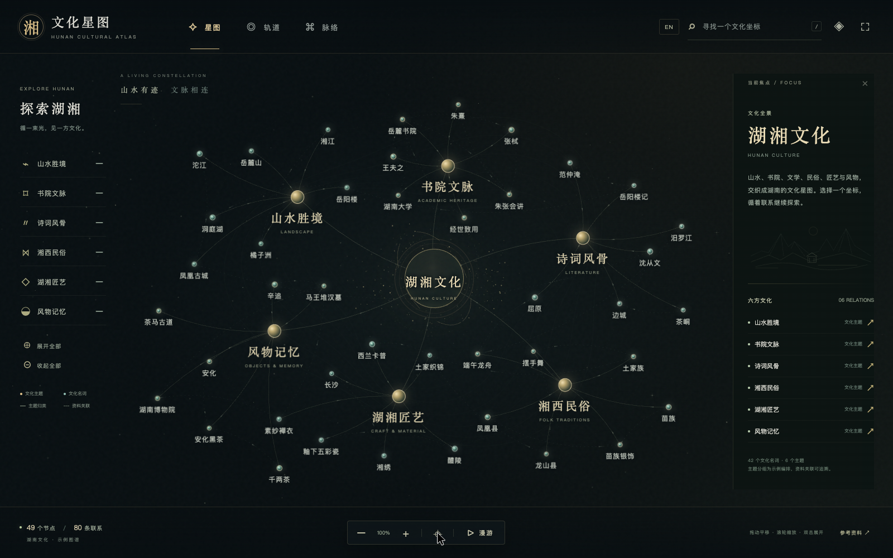

# 湘 · 文化星图

[English](README_en.md) · 中文

湖南文化知识图谱的前端视觉原型。49 个节点：42 个文化名词、6 个主题、1 个文化根节点；80 条联系：48 条主题编排、32 条有资料依据的文化关联。

提供完整中英双语版本。点击右上角 `EN` / `中文` 切换界面、图谱标签、文化简介、关系名称和参考资料说明；切换语言会保留当前选择、布局和分支状态。英文说明见 `README_en.md`。



[英文效果图](docs/assets/overview-en.png) · [聚焦效果图](docs/assets/focus-zh.png) · [实际操作演示](docs/assets/demo.mp4)

## 体验

```sh
git clone https://github.com/maolinqi/hunan-culture-atlas.git
cd hunan-culture-atlas
```

打开 `dist/index.html` 即可体验，无需安装前端依赖。所有节点、连线、光晕、轨道与粒子都由前端实时绘制，文件本身可以离线运行。

也可直接打开仓库根目录的 `standalone.html`。它将全部前端代码打包在单个 HTML 中，便于复制给别人。

- 星图、轨道、脉络：三种布局平滑过渡。
- 单击节点：聚焦并高亮相邻联系，右侧显示文化资料与关联坐标。
- 双击主题节点，或点击主题右侧的加减号：展开、收起分支。
- 拖动空白画布平移，滚轮缩放；触屏支持双指缩放。
- 拖动节点可以微调位置，点击全景按钮复位。
- 搜索名词，或点击漫游自动探索。点击节点即可接管漫游。
- 右上角可以调节粒子、关系流光、呼吸与涟漪，以及切换沉浸模式。
- 快捷键：`/` 搜索，`+`/`-` 缩放，`0` 全景，`Esc` 停止漫游或退出沉浸。
- 系统设置为“减少动态效果”时，默认关闭环境动效，布局过渡即时完成。

## 本地运行

```sh
./setup.sh
./start_all.sh
./stop_all.sh
```

初始化使用项目独立 `.venv`，只需 Python 标准库；启动不重复安装。默认地址 `http://127.0.0.1:8789`。可用 `XIANG_ATLAS_PORT=8790 ./start_all.sh` 指定端口。

## 实现

原生 HTML、CSS、JavaScript。Canvas 绘制曲线、轨道、粒子、光晕、箭头与关系标签；DOM 绘制文字与可访问的节点按钮。没有 CDN、模型调用、后台服务或知识生产流程。字体优先使用设备自带中文字体，跨设备字形会有差别。

本原型针对这 49 个节点做了人工布局编排，追求首屏审美与可读性。它已实现的效果可直接复用；不代表已经验证百万级图谱性能。扩大到大量节点时可以使用 D3 的力布局与碰撞避让、Sigma.js 的 WebGL 渲染、层级聚合与标签按缩放显示。

## 内容边界

实线表示示例主题归类，虚线表示附资料来源的文化关联；选择节点后，资料关联显示方向和关系名。光点流动表达视觉关联，不代表历史因果。

主题分类是为了演示而人工编排。例如“湘西民俗”中纳入端午龙舟是跨主题示例，不把汨罗归为湘西。茶马古道为茶叶商贸的主题意象，没有主张某条具体路线。《边城》的原型地是茶峒，与凤凰古城分别呈现。

文化与技术的参考链接可在页面底部“参考资料”中查看；调研与设计说明见同目录 `视觉方案与参考资料.md`。

## 全部源码与修改入口

`dist/` 中的文件就是原生前端源码，不是压缩产物；仓库中包含页面所需的全部运行代码。

| 文件 | 用途 |
| --- | --- |
| `dist/index.html` | 页面结构、操作入口与信息面板 |
| `dist/style.css` | 色彩、字体、节点、布局与响应式样式 |
| `dist/app.js` | 完整文化示例数据、关系、布局、渲染与交互逻辑 |
| `dist/i18n.js` | 英文节点、文化简介、关系名称与界面翻译 |
| `server.py` | 只使用 Python 标准库的本地静态预览服务 |
| `setup.sh` / `start_all.sh` / `stop_all.sh` | 项目独立环境与预览管理 |
| `scripts/build_standalone.py` | 从上述前端源码重新生成离线单文件 |
| `standalone.html` | 可直接打开的完整离线版本 |
| `docs/assets/` | 实际页面截图与操作录屏 |

修改前端后，可重新生成离线版：

```sh
python3 scripts/build_standalone.py
```

无外部前端依赖，不需要 Node.js、数据库、API 密钥或模型服务。虚拟环境、缓存、运行日志和原私有站点的部署身份不属于源码，未随公开仓库提交。

## 许可证

本仓库代码采用 [MIT License](LICENSE)，可以下载、修改、复用和分发。链接到的第三方资料保留各自的权利。
