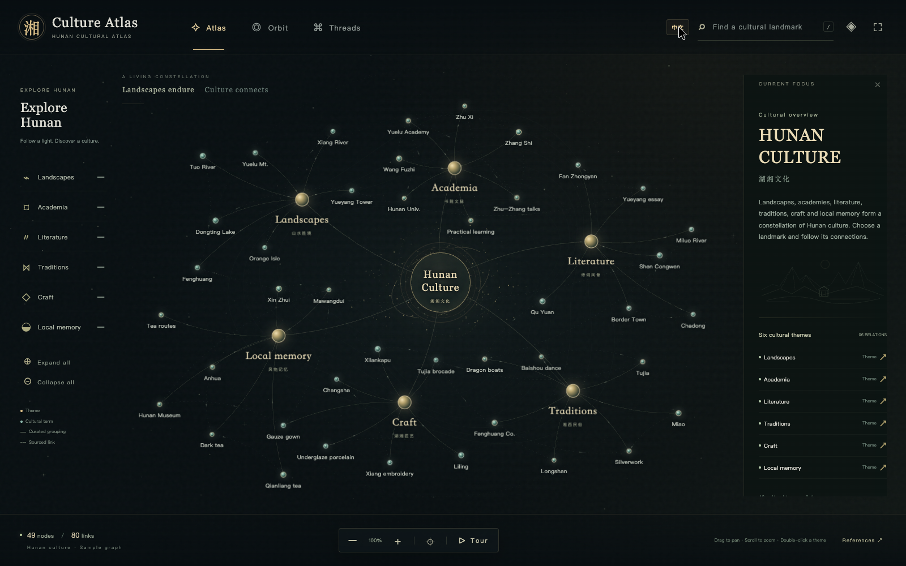

# Hunan · Culture Atlas

English · [中文](README.md)

A bilingual frontend prototype for a Hunan cultural knowledge graph. It contains 49 nodes: 42 cultural terms, 6 curated themes and 1 root node. Of its 80 links, 48 are theme-grouping links and 32 are cultural connections with sources.



[Chinese overview](docs/assets/overview-zh.png) · [Focused view](docs/assets/focus-zh.png) · [Recorded interaction demo](docs/assets/demo.mp4)

```sh
git clone https://github.com/maolinqi/hunan-culture-atlas.git
cd hunan-culture-atlas
```

Open `dist/index.html` to explore. No frontend dependencies, CDN, model calls or backend are needed. All nodes, curves, light trails, particles and halos are rendered live. The prototype works offline.

You can also open `standalone.html` in the repository root. It contains the complete frontend in a single HTML file, suitable for offline sharing.

Use the top-right `EN` / `中文` button to switch the interface, graph labels, cultural descriptions, relation names and reference notes. The current layout, selection and collapsed branches are preserved. Both English and Chinese search terms work in either language.

- Three animated layouts: Atlas, Orbit and Threads.
- Click a node to focus on its neighbours and view cultural details.
- Double-click a theme, or use its plus/minus control, to expand or collapse it.
- Drag the canvas to pan; scroll or pinch to zoom. Drag individual nodes to adjust their position.
- Search for a term or use Tour for automatic exploration. Select a node to take over.
- Set ambient particles, link light trails, breathing and ripples independently. Motion intensity is adjustable.
- Reduced motion is respected by default when enabled in system settings.
- Keyboard: `/` search, `+` / `-` zoom, `0` reset, `Esc` stop the tour or exit immersive view.

## Local preview

```sh
./setup.sh
./start_all.sh
./stop_all.sh
```

Setup creates a project-specific Python `.venv` and uses only the standard library. Starting the preview never reinstalls dependencies. The default local address is `http://127.0.0.1:8789`. Use `XIANG_ATLAS_PORT=8790 ./start_all.sh` to change the port.

## Design and implementation

Ink black, jade and aged gold form a restrained cultural constellation. Canvas draws curves, particles, orbit lines, halos, arrows and relation labels. DOM elements provide text, controls and accessible node buttons. The device’s local fonts are used, so typefaces can differ across platforms.

This 49-node demonstration uses curated positions. It proves the implemented visual effects, not performance at very large graph sizes. For larger graphs, the extension path includes D3 layouts and collision avoidance, Sigma.js WebGL rendering, theme aggregation and labels at different zoom levels.

## Content boundaries

Solid lines represent curated theme grouping; dashed lines represent sourced cultural links. Highlighted sourced links display their names and direction. Moving particles express visual connection, not historical causation.

Themes are composed for this demonstration. The Miluo dragon-boat tradition is included under Traditions as a cross-theme example; Miluo is not presented as part of western Hunan. Tea trade routes are a thematic motif, without a claim about a specific route. Chadong, the literary setting of Border Town, is shown separately from Fenghuang.

The References dialog includes 24 cultural and visual sources, with notes in both languages. See `Visual-design-and-references.md` for the design rationale and implementation boundaries.

## Complete source and editing

The files in `dist/` are the original, readable frontend source, not minified build output. This repository contains all code needed to run the page.

| File | Purpose |
| --- | --- |
| `dist/index.html` | Page structure, controls and detail panels |
| `dist/style.css` | Colours, typography, nodes and responsive layout |
| `dist/app.js` | Complete sample data, links, layouts, rendering and interaction logic |
| `dist/i18n.js` | English node names, cultural descriptions, relations and interface text |
| `server.py` | Local preview using the Python standard library |
| `setup.sh` / `start_all.sh` / `stop_all.sh` | Project environment and preview lifecycle |
| `scripts/build_standalone.py` | Rebuilds the single-file offline version |
| `standalone.html` | Ready-to-open offline version |
| `docs/assets/` | Actual page screenshots and recorded interactions |

After editing the frontend, regenerate the offline version with:

```sh
python3 scripts/build_standalone.py
```

No Node.js, database, API key or model service is required. Virtual environments, caches, runtime logs and the original private Site deployment identity are not source files and are not included in this public repository.

## License

The repository code is available under the [MIT License](LICENSE) for downloading, modification, reuse and redistribution. Linked third-party materials retain their respective rights.
